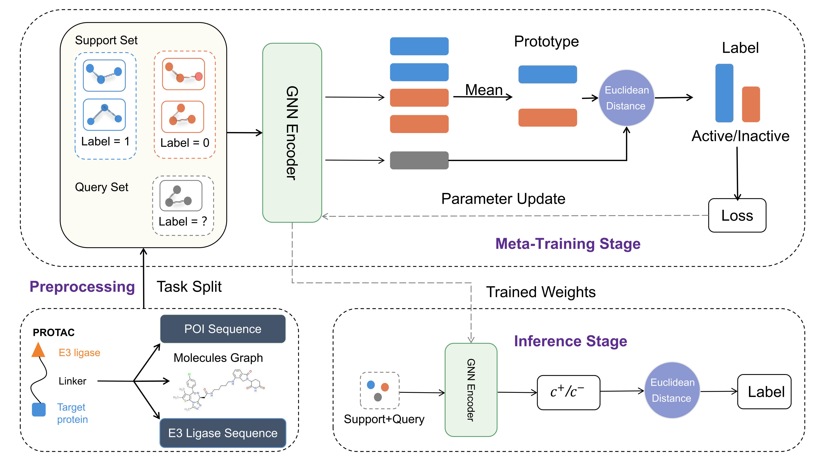
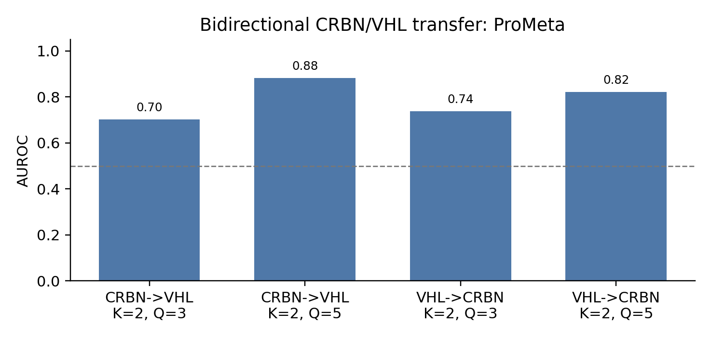
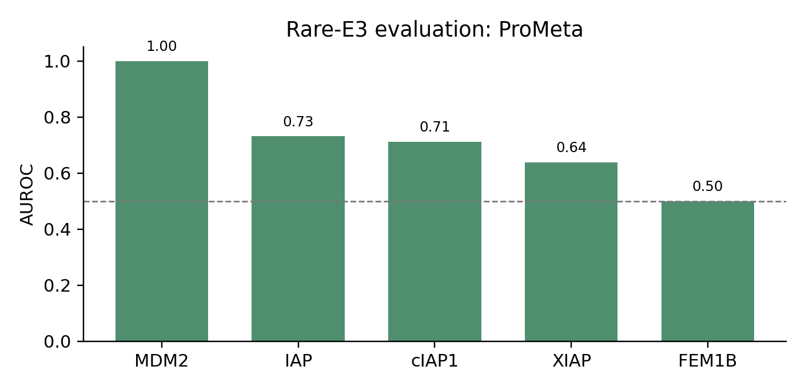

# ProMeta

Few-shot PROTAC-targeted degradation prediction across E3 ligases.

[](https://doi.org/10.5281/zenodo.21371599)

ProMeta learns a molecule--protein representation from a source E3 ligase and performs
held-out target-ligase prediction by constructing active/inactive prototypes
from a small labeled support set. The sequence-aware model combines a molecular
GCN with separate POI and E3 encoders through trainable scalar weights. This
public release contains the integrated implementation, the exact retained
experimental source snapshot, a checkpoint-provenance audit, and the later
numerical-reproduction package. Results from other prediction methods are
deliberately excluded.

<p align="center">
  
</p>

## Release contents

- `prometa/`: molecular and POI/E3 sequence models, joint episodic training,
  prototype inference, metrics, and the RDKit-3D descriptor control.
- `experiments/`: split builders, training/evaluation entry points, experiment
  registry, and response-letter consistency checks.
- `data/`: the compound-linked POI/E3 sequence table, the 1,386-context strict CRBN/VHL table, the full labeled context
  table used for rare-E3 evaluation, graph cache, intersection table, and 3D
  descriptor cache.
- `splits/response_letter/`: retained target support/query split profiles.
- `splits/source_development/`: deterministic 80/20 source-Target development
  partitions and source-validation episodes for each source ligase and seed.
- `splits/by_experiment/`: one explicitly named split directory for every
  reported experiment; R9/VZ185 directories contain clearly marked frozen
  cohorts because no standalone historical support/query split was retained.
- `checkpoints/by_experiment/`: one explicitly named checkpoint artifact for
  every reported ProMeta experiment. Encoder-backed experiments contain
  byte-identical encoder copies; historical audits without a complete retained
  model/input pair contain frozen prediction checkpoints.
- `checkpoints/sequence_aware/`: retained POI/E3/GCN checkpoint triplets for
  the main seed-42 run and the rare-E3 K=1,Q=1 runs.
- `archive/sequence_aware_source/`: exact self-contained experimental source
  snapshot from which the protein branch was integrated into `prometa/`.
- `results/released/`: ProMeta-only query predictions and summaries reported in
  the response letter.

The strict CRBN/VHL table contains 1,386 unique compound--E3--target contexts:
842 CRBN and 544 VHL, with 690 positive and 696 negative labels.

## Response-letter experiment map

| Table | ProMeta experiment | Public entry point |
|---|---|---|
| S2 | Shared-intersection, bidirectional K=2 evaluation | `evaluate_prometa.py` |
| S3 | Bidirectional CRBN/VHL fixed-query evaluation | `evaluate_prometa.py` |
| S4--S5 | Rare-E3 common-query evaluation and audit | `evaluate_prometa.py`, `summarize_rare_e3.py` |
| S6 | Prototype versus support-trained linear head | `evaluate_prometa.py` |
| S7 | ProMeta, linear-head, and no-episodic variants | `train_prometa.py`, released predictions |
| S8 | ProMeta plus RDKit conformer descriptors | `evaluate_prometa_3d.py` |
| S9 | K/Q and all-remaining-query sensitivity | `evaluate_prometa.py` |
| R9 case families | CDK6 and BCL-xL series with the main S3 checkpoint | released compound predictions |
| VZ185 | Retrospective 12-compound correctness audit | released compound audit |

`experiments/response_letter_experiments.csv` records each split profile,
retained source-checkpoint family, head, K/Q setting, and data table. The
direct run-time paths are in `experiment_checkpoint_manifest.csv`. In
particular:

- S3 K=2,Q=3 and the S9 analyses use the BCR--ABL-excluded profile where stated
  in the response letter.
- S3 K=2,Q=5 and S6 use the original fixed-query profile.
- S9 K=2 all-remaining-query uses its corresponding K/Q-specific checkpoint.
- S6 linear-head rows use the corresponding K/Q-specific ProMeta checkpoint;
  prototype rows use the recovered global checkpoint.
- Rare-E3 S4 metrics pool the 90 episode-level common-query rows, rather than
  averaging one metric value per seed.

`experiments/experiment_checkpoint_manifest.csv` and
`experiments/experiment_split_manifest.csv` map every reported experiment and
seed to its dedicated checkpoint and split paths and record source/copy
SHA-256 hashes.

## Sequence-aware implementation and provenance

The reported sequence-aware encoder is implemented in `prometa/model.py` and
`prometa/training.py` as

```text
z = z_mol + alpha_poi * z_poi + alpha_e3 * z_e3
```

The GCN, POI encoder, E3 encoder, `alpha_poi`, and `alpha_e3` are jointly
optimized. The exact retained source snapshot is
`archive/sequence_aware_source/run_baselines_vhl.py`; the compound-linked
inputs are `data/protac_with_seq.csv`.

`experiments/sequence_checkpoint_manifest.csv` records retained and missing
artifact roles rather than silently substituting files. The complete
GCN/POI/E3 triplet is retained for the main seed-42 run, and all three triplets
are retained for rare-E3 K=1,Q=1. For main seeds 2025 and 3407, the molecular
GCN branches are retained but the original dual-sequence sidecars are not;
those missing files are explicitly marked `not_retained_not_reconstructed`.

Verify every retained hash, strict-load every neural checkpoint, compare the
main seed-42 GCN with the byte-identical numerical-release copy, and audit the
joint optimizer registration:

```bash
python experiments/verify_sequence_provenance.py
```

Run the retained main seed-42 sequence-aware inference path on the four S3
support/query settings:

```bash
python experiments/evaluate_sequence_aware.py --device cpu
```

This sequence-provenance run is separate from the three-seed numerical audit:
the latter reproduces the rounded response-letter values from retained GCN
branches, splits, and frozen outputs and must not be interpreted as proof that
all historical dual-sequence sidecars survived packaging.

## Environment

Create the recorded environment:

```bash
conda env create -f environment.yml
conda activate prometa
```

For a CPU-oriented pip installation, the equivalent direct dependencies are
also listed in `requirements.txt`:

```bash
python -m pip install -r requirements.txt
```

All evaluation commands also run on CPU by passing `--device cpu`.

## One-command reproduction

From the repository root, the following command verifies the downloaded
files, recomputes every public ProMeta experiment, and runs the numerical
audits:

```bash
bash run_all_experiments.sh
```

Set `DEVICE=cuda` to use a CUDA device. Fresh results are written only under
`results/recomputed/`; the immutable references remain under
`results/released/`.

## Rebuild the frozen splits

The builders are deterministic and use seeds 42, 2025, and 3407:

```bash
python experiments/build_response_splits.py --profile all
python experiments/build_rare_common_query_splits.py
python experiments/materialize_experiment_splits.py --force
```

## Source-only model selection and target-label isolation

Numerical reproduction of the reported values uses the retained frozen
checkpoints described below.  Separately, the repository provides an auditable
retraining path that implements the stated source-development boundary without
claiming to reconstruct unretained historical selection logs.

Build the deterministic 80/20 source-Target partitions and source-validation
episodes for CRBN and VHL under seeds 42, 2025, and 3407:

```bash
python experiments/build_source_development_splits.py
```

The generated `splits/source_development/source_target_partitions.csv` records
every source Target and its partition.  Each source-development JSON contains
only source-E3 Targets and explicitly records `held_out_target_e3_access: none`.
Audit the full selection plan without training:

```bash
python experiments/run_source_selection_workflow.py \
  --source-e3 CRBN --seed 42 --dry-run
```

Remove `--dry-run` to train every configuration in
`experiments/source_selection_candidates.csv`, rank checkpoints by source-only
validation AUROC and then AUPRC, and freeze the selected GCN/POI/E3 triplet.  A
held-out target split may be supplied only for the post-selection evaluation:

```bash
python experiments/run_source_selection_workflow.py \
  --source-e3 CRBN --seed 42 --device cpu \
  --target-split splits/response_letter/bcr_abl_excluded/crbn_train_vhl_test_strict_K2Q3_seed42.json
```

The workflow verifies that source-training and source-validation Targets are
disjoint and jointly cover the source ligase.  The target split is not opened
until after source-validation checkpoint selection.  Within target evaluation,
support labels construct the prototypes, probabilities are computed without
query labels, and query labels are retained only for metric calculation.

## Reproduce ProMeta performance

The upload directory already contains all dedicated checkpoints and splits.
To rebuild them from the retained source artifacts, run:

```bash
python experiments/materialize_experiment_checkpoints.py --force
python experiments/materialize_experiment_splits.py --force
```

Re-evaluate all checkpoint-backed rows in S2, S3, S4--S6, and S9:

```bash
python experiments/evaluate_prometa.py --device cpu
```

This writes one directory per experiment under `results/recomputed/`. Pool the
rare-E3 common-query predictions exactly as in S4:

```bash
python experiments/summarize_rare_e3.py
```

Reproduce the ProMeta/RDKit-3D rows in S8:

```bash
python experiments/evaluate_prometa_3d.py --device cpu
```

Recompute the exact S7, compound-family, and legacy VZ185 values from their
dedicated frozen-prediction checkpoints:

```bash
python experiments/evaluate_frozen_checkpoints.py
```

Verify that every dedicated artifact exists, is stored under the correct
experiment ID, and matches its recorded source/checkpoint SHA-256:

```bash
python experiments/verify_experiment_checkpoints.py
python experiments/verify_experiment_splits.py
```

Verify the integrity of the complete downloaded release:

```bash
python scripts/verify_release_checksums.py
```

Train the sequence-aware ProMeta encoder from source-ligase data. The command
saves the GCN checkpoint plus POI and E3 sidecars; pass
`--without-protein-sequences` only for the explicitly labeled GCN-only path:

```bash
python experiments/train_prometa.py --source-e3 CRBN --mode episodic --device cpu \
  --output checkpoints/new/prometa_crbn_seed42.pt
```

Finally, audit every released rounded value and confirm that no result table
contains a non-ProMeta method:

```bash
python experiments/verify_response_letter.py
```

The expected successful result is `230` table checks, `21` scope checks, and
zero failures.

## Main ProMeta-only figures

<p align="center">
  
</p>

<p align="center">
  
</p>

## VZ185 provenance

The response letter reports 11/12 correct predictions (91.7%) for the legacy
Excel-order VZ185 cohort. The released audit preserves that exact 12-row order.
Because the historical sheet did not contain stable compound identifiers or
calibrated ProMeta probabilities, this release treats the result as a frozen
retrospective correctness audit rather than a newly reconstructed probability
benchmark.

Reproduce this case-study result directly from the repository root:

```bash
python case.py
```

The command verifies the expected 11/12 result and writes compound-level
predictions and a summary under `results/recomputed/vz185_case/`.

## Case-study checkpoint provenance

The full checkpoint audit evaluated the CDK6, NAMPT, BTK, and BCL-xL series
with the same main full-data checkpoint family used in S3:
`checkpoints/prometa_global/protonet_encoder_seed{seed}.pt`. Compound
membership and each family's original support/query split were held fixed, and
each split was paired with the checkpoint from the same seed. The resulting
correct-classification counts are 11/14, 6/12, 6/10, and 6/6, respectively.
Response-letter Table R9 reports only the CDK6 and BCL-xL series (11/14 and
6/6 correct classifications, respectively); the other two series remain in
the released audit files for provenance.
`results/released/four_family_main_checkpoint_compound_predictions.csv`
provides the experimental annotations, compound-level probabilities, binary
predictions, and correctness indicators; the companion summary provides the
family-level metrics.

## Build the ProMeta-only upload directory

The development worktree may contain historical manuscript and revision files.
Do not upload it wholesale. Build a clean, checksum-audited release directory:

```bash
python scripts/export_prometa_release.py --force
```

Upload `dist/ProMeta/`. The exporter validates that every public result row is
a ProMeta method or ProMeta variant and excludes all historical baseline
artifacts.

## Citation

If you use ProMeta or these revision experiments, please cite the associated
paper and archived code/data release.
